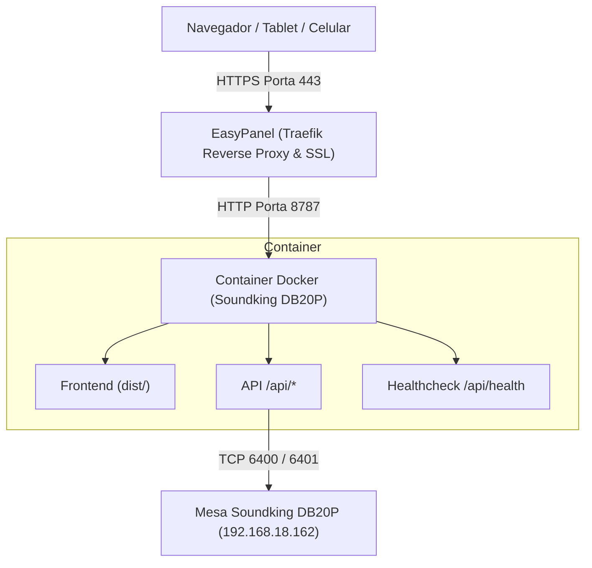

# Guia de Deploy no EasyPanel · Soundking DB20P Controller

Este documento orienta o deploy da aplicação **Soundking DB20P Controller** no [EasyPanel](https://easypanel.io/) (painel Docker moderno com proxy reverso Traefik, SSL automático e zero-configuração manual).

---

## 1. Visão Geral da Arquitetura em Produção

O projeto foi preparado em uma **arquitetura unificada em container Docker multi-stage**:
- **Frontend SPA**: Compilado com Vite (React 19, Lucide, Tailwind/CSS otimizado) em `/dist`.
- **Backend Node.js**: Serve os arquivos estáticos compilados e gerencia as conexões TCP/UDP com a mesa digital, streaming de medidores (SSE) e API REST.
- **Porta padrão**: `8787` (customizável via variável de ambiente `PORT`).
- **Healthcheck**: Endpoint `/api/health` e `/health` integrado para zero-downtime deploys.

---

## 2. Passo a Passo no EasyPanel

### Passo 1: Criar o Projeto
1. Acesse seu painel do EasyPanel (`https://seu-painel.com`).
2. Clique em **+ New Project** (ou use um projeto existente) e nomeie como `mesa-digital` ou `soundking`.

### Passo 2: Criar o Serviço (App)
1. Dentro do projeto, clique em **+ Service** e selecione a opção **App**.
2. Nomeie o serviço como `db20p-controller`.

### Passo 3: Configurar a Origem (Source)
1. Na aba **Source**:
   - Selecione **GitHub** (ou **Git Repository**).
   - Conecte o repositório do projeto.
   - Defina a branch (geralmente `main`).
2. Em **Build**:
   - Selecione o método **Dockerfile**.
   - O EasyPanel utilizará automaticamente o `Dockerfile` multi-stage presente na raiz do repositório.

### Passo 4: Configurar a Porta da Aplicação
1. Na aba **General** ou **Networking**:
   - Em **Port**, digite: `8787`.

### Passo 5: Configurar Variáveis de Ambiente (Environment)
Na aba **Environment**, adicione as seguintes variáveis:

| Variável | Valor Padrão | Descrição |
| :--- | :--- | :--- |
| `NODE_ENV` | `production` | Otimizações de performance do Node.js |
| `PORT` | `8787` | Porta interna do container |
| `HOST` | `0.0.0.0` | Permite conexões externas no container |
| `ALLOWED_ORIGINS` | `*` | Domínio do painel ou `*` para liberar CORS |
| `DEFAULT_MIXER_HOST` | `192.168.18.162` | IP padrão da mesa Soundking DB20P |

> [!TIP]
> Se você for usar um domínio específico (ex: `https://mesa.minhaigreja.com`), você pode definir `ALLOWED_ORIGINS=https://mesa.minhaigreja.com`. Para redes internas ou múltiplos acessos, o valor `*` funciona perfeitamente.

### Passo 6: Configurar o Domínio e SSL
1. Na aba **Domains**:
   - Clique em **+ Add Domain**.
   - Digite seu domínio ou subdomínio (ex: `mesa.seudominio.com`) ou use o subdomínio gratuito gerado pelo EasyPanel.
   - O EasyPanel gerencia e renova o certificado SSL via Let's Encrypt automaticamente.

### Passo 7: Fazer o Deploy
1. Clique no botão **Deploy**.
2. Acompanhe os logs de build em tempo real:
   - Instalação das dependências.
   - Build do frontend (`npm run build`).
   - Inicialização do servidor unificado em `http://0.0.0.0:8787`.
3. Assim que o healthcheck confirmar o status `healthy`, o serviço estará ativo!

---

## 3. Conectividade de Rede com a Mesa Digital

A Soundking DB20P opera através de conexão de rede local (portas TCP 6400 e 6401):

### Cenário 1: EasyPanel rodando em servidor local (Recomendado para eventos ao vivo)
- Se o EasyPanel está instalado em um Mini PC, Raspberry Pi ou servidor local conectado à mesma rede da mesa (ex: via cabo de rede ou mesmo roteador Wi-Fi):
  - **Acesso direto**: O container comunica normalmente com o IP da mesa (`192.168.18.162`).
  - O EasyPanel pode ser acessado de qualquer tablet, celular ou notebook na rede.

### Cenário 2: EasyPanel rodando em VPS na Nuvem (DigitalOcean, AWS, Hetzner, etc.)
- Servidores na nuvem não têm acesso direto à sua rede local privada (`192.168.x.x`). Para conectar à mesa física a partir da nuvem:
  - **Opção A (Tailscale / VPN)**: Instale o Tailscale no host do EasyPanel e em um computador na rede da mesa, criando uma subnet router.
  - **Opção B (Modo Simulado / Treinamento)**: Sem conectar na mesa real, o sistema carrega o snapshot simulado offline integrado (`response-6400.bin`) com medidores realistas e suporte completo para montagem de cenas e equalização.

---

## 4. Teste e Validação Pós-Deploy

1. Abra a URL configurada no navegador.
2. Acesse a aba **Conexão**:
   - Verifique o status da ponte.
   - Teste o envio de snapshot ou conexões na porta `6400`.
3. Verifique a URL `/api/health`:
   - Deve retornar status `200` com `{ status: "ok", uptime: ..., transport: ... }`.

---

## 5. Arquivos de Deploy Incluídos no Repositório

- [Dockerfile](file:///Users/flavio/Downloads/mesa_digital/projeto_mesa/Dockerfile): Multi-stage build otimizado (Node 22 Alpine).
- [.dockerignore](file:///Users/flavio/Downloads/mesa_digital/projeto_mesa/.dockerignore): Exclusão de pastas locais pesadas e caches.
- [docker-compose.yml](file:///Users/flavio/Downloads/mesa_digital/projeto_mesa/docker-compose.yml): Definição para deploy via compose ou teste local com `docker compose up`.
- [package.json](file:///Users/flavio/Downloads/mesa_digital/projeto_mesa/package.json): Script `"start": "node server/index.js"`.
- [server/index.js](file:///Users/flavio/Downloads/mesa_digital/projeto_mesa/server/index.js): Servidor unificado SPA + API REST + SSE medidores + Healthcheck.
